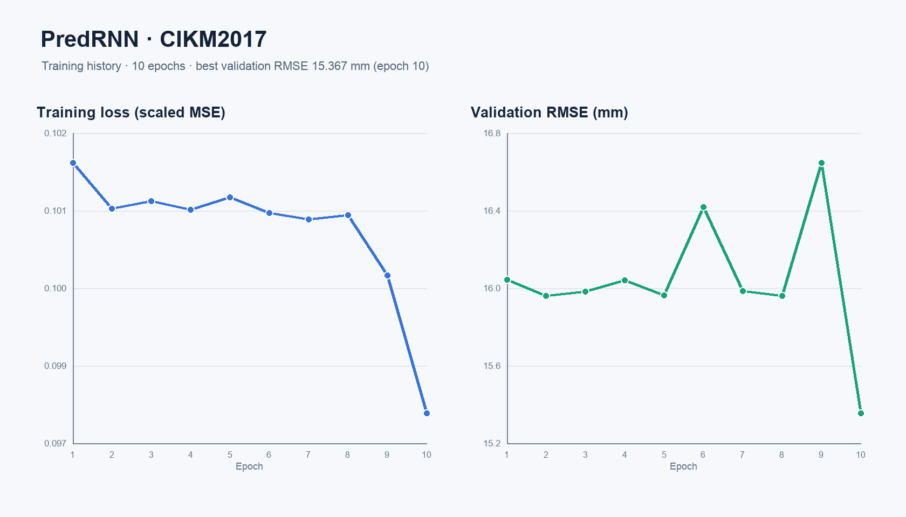
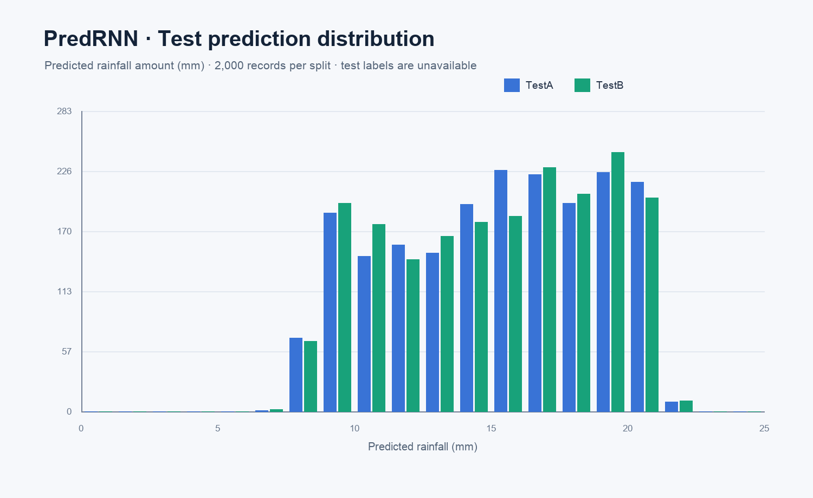

# PredRNN — CIKM2017 短时降水预测

使用 PredRNN 的时空 LSTM（ST-LSTM）编码雷达回波序列，并回归未来 1–2 小时的降水量。项目针对 CIKM2017 提供的单个降水量标签，在 PredRNN 编码器后增加回归头。比赛以 RMSE 评估预测误差。

> 本仓库包含代码、训练权重、指标、图表和 TestA/TestB 预测文件。原始数据包没有复制进来：训练数据解压后约 16 GB，测试集各约 3.1 GB。请使用你已有的三个数据包，按 [`data/README.md`](data/README.md) 放置文件。

## 结果

- 训练集共 10,000 条：9,000 条训练，1,000 条验证（seed 42）。
- 输入为 15 个时间点 × 4 个高度 × 101 × 101 网格；ST-LSTM 前用 4×平均池化降到约 26 × 26，以适配本机 CPU。
- 训练 10 个 epoch；最佳验证 RMSE：**15.36697**（第 10 轮）。
- TestA 和 TestB 各有 2,000 条预测。测试标签未提供，因此没有测试 RMSE。
- 运行硬件：Apple M4、16 GB 内存；PyTorch 2.14.0 在当前 macOS 27 环境下未启用 MPS，本次训练使用 CPU。

### 训练曲线



### 测试集预测分布



## 文件结构

```text
PredRNN/
├── .vscode/                 # VS Code 调试配置
├── data/                    # 数据路径说明，不含原始数据
├── figures/                 # 训练曲线和预测分布图
├── outputs/
│   ├── predrnn_cikm2017_best.pt
│   ├── training_metrics.json
│   ├── testA_predictions.csv # 含样本 ID
│   ├── testA_submission.csv  # 单列、无表头、按原顺序
│   ├── testB_predictions.csv
│   └── testB_submission.csv
├── data_io.py
├── model.py
└── train.py
```

## 在 VS Code 中运行

1. 使用 **File → Open Folder…** 打开 `PredRNN` 文件夹。
2. 在集成终端创建环境并安装依赖：

   ```bash
   python3 -m venv .venv
   source .venv/bin/activate
   python -m pip install --upgrade pip
   pip install -r requirements.txt
   ```

3. 按 [`data/README.md`](data/README.md) 将解压后的数据放到 `data/raw/data_new/`。
4. 在 **Run and Debug** 中选择 **Train PredRNN on CIKM2017**；或运行：

   ```bash
   python train.py --epochs 10 --batch-size 4 --hidden 8
   ```

训练日志、最优检查点和 TestA/TestB 预测写入 `outputs/`。若要从已有权重继续训练，可使用：

```bash
python train.py --epochs 20 --batch-size 4 --hidden 8 --resume outputs/predrnn_cikm2017_best.pt
```

`--epochs 20` 表示总目标轮数，而不是额外再跑 20 轮。

## 依赖和实现参考

- Python 3.13、PyTorch 2.x、NumPy、Pillow
- PredRNN ST-LSTM 架构参考 [THUML PredRNN PyTorch 实现](https://github.com/thuml/predrnn-pytorch)。
- CIKM2017 任务定义和 RMSE 指标见[比赛论文](https://cikm2017.org/download/analytiCup/session1/CIKMAnalytiCup2017_SZMBAlibabaPrecipitationForecast_T1.pdf)。
- 数据集页面：[阿里云天池 CIKM AnalytiCup 2017 数据集](https://tianchi.aliyun.com/dataset/1085)。
